# 🐉 Cestille Hub — Interactive 3D Universe, Colony Builder & Dragon Battle Arena

[](https://teste.gabriel1-cestille.workers.dev)
[](https://threejs.org/)
[](LICENSE)

> **A browser-native 3D interactive ecosystem** combining a playable **Solar System Universe Hub**, a **3D Colony Builder**, a **Neon Street Productivity View**, and a **Tactical 3D Dragon Battle Arena** — built with Three.js, custom GLSL shaders, procedural + skeletal 3D animation, diegetic UI, and cloud save sync. Runs instantly on Desktop, iPad, and iPhone (landscape) with zero installation.

<p align="center">
  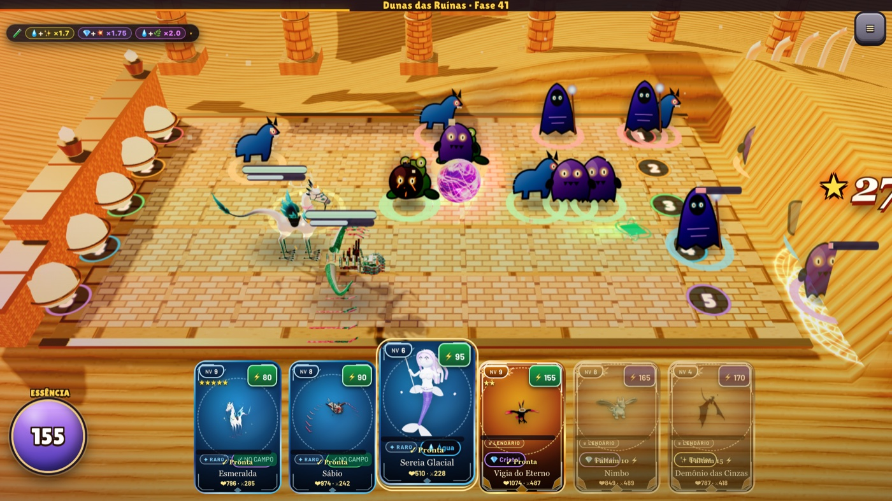
  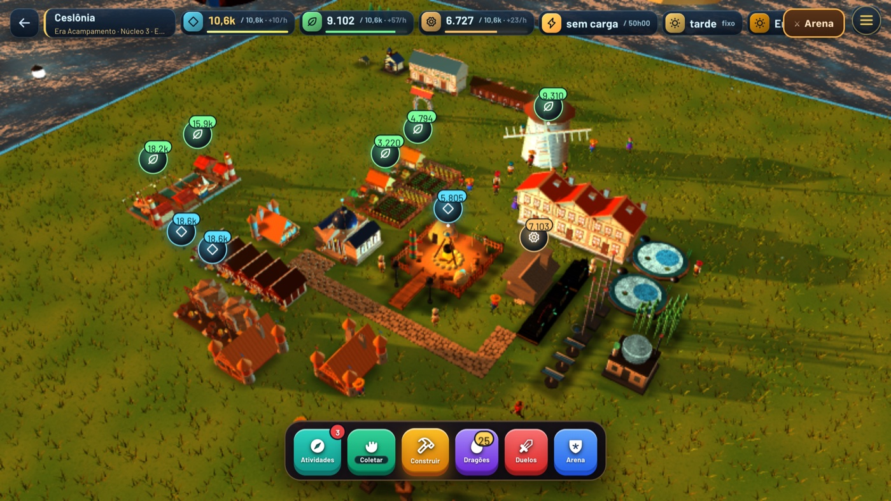
</p>
<p align="center">
  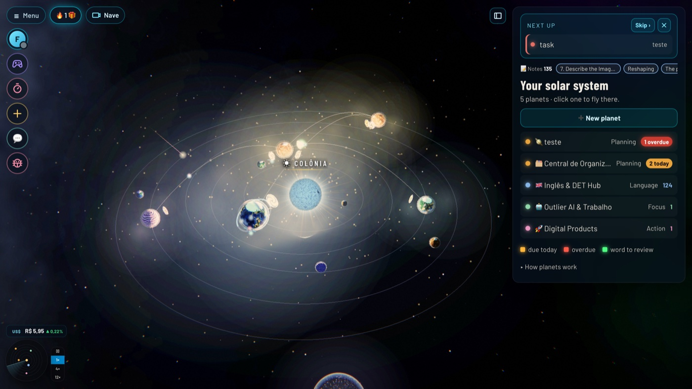
  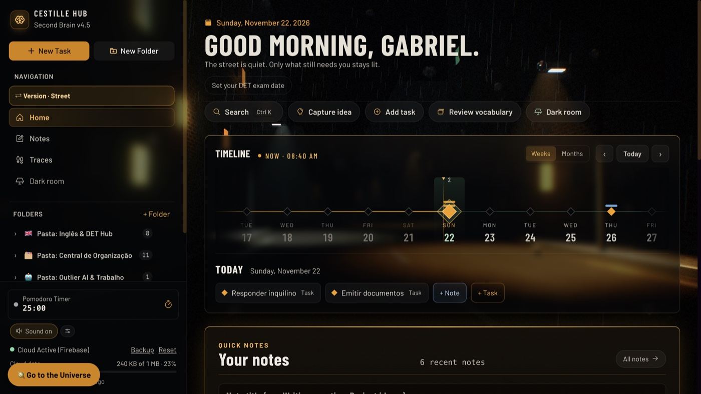
</p>

---

## ✨ Four Integrated Experiences

### 🌌 1. Interactive 3D Universe Hub
- Real-time Three.js solar system with glowing central star, orbiting 3D worlds, orbital rings, radar minimap, and smooth camera transitions into every experience.

### 🏰 2. 3D Colony Builder & Breeding Incubator
- Interactive 3D island with dynamic day/night lighting, architectural buildings (Castle, Windmill, Forge, Crystal Mine, Observatory, Incubator Tree), resource economy, villagers, and dragon breeding with elemental synergies and rarity pity.

### ⚔️ 3. Tactical 3D Dragon Battle Arena
- **31 Unique 3D Creatures:** Each dragon/creature features a distinct `.glb` mesh or procedural Three.js sculpt, studio-rendered portraits, tactical combat roles (*Tank, Shooter, Control, Artillery, Support*), and elemental passives.
- **Real-Time Elemental Combo System:** Six elemental reactions (`💧+🔥 Thermal Shock`, `💧+✨ Electric Conduction`, `🌿+🔥 Wildfire`, `💎+💥 Prismatic Refraction`, `💧+💧 Freezing Tide`, `💧+🌿 Shatter ×2.0`) with 3D burst rings, custom floating combat typography, and an interactive in-battle combo HUD.
- **Multi-Act Camera Cinematics (`warCinePlay`):** Scenic arena intro sweep, seismic boss entrance with procedural stomp audio, 2-act Legendary Special cinematics, and slow-motion final-blow camera.
- **Roguelike Endless Mode & Meta-Progression:** Survival waves carrying over surviving units and essence with a 1-of-3 **Boon Draft** per wave, Campaign with unique bosses, Weekly Boss, Daily Missions, Achievements, Daily Arcane Shop, and Collection Album.

### 🌆 4. Neon Street Workspace
- Atmospheric rainy neon street view integrating daily timeline, tasks, and quick notes synced to the cloud.

---

## ⚒️ Diegetic Fantasy UI ("Obsidian & Brass")

The **Ancestral Forge**, **Dragon Sanctuary**, and **Arcane Shop** are crafted as full-bleed diegetic stages over painted artwork, with levitating relics, diffused volumetric lighting, circular forged rune sockets, and GPU-accelerated hover transitions.

<p align="center">
  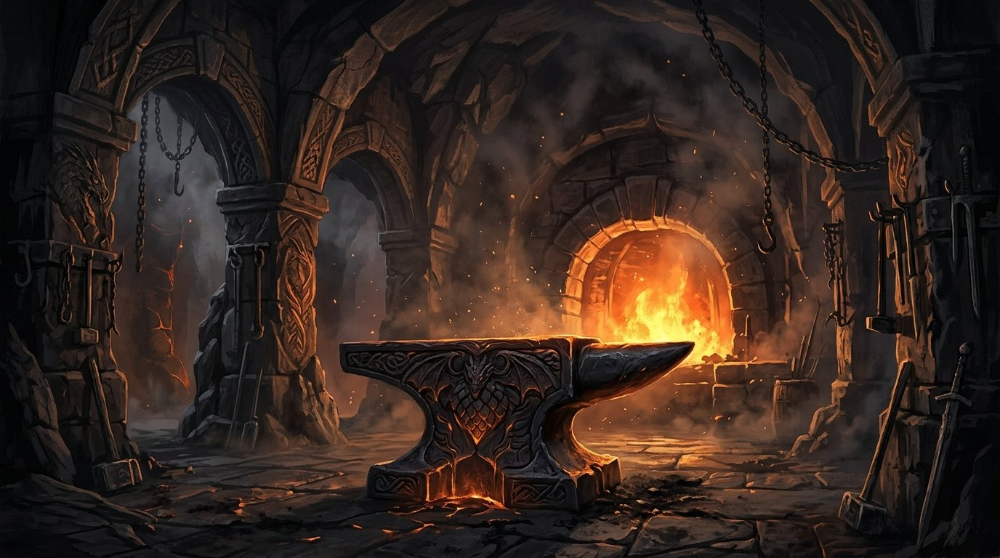
  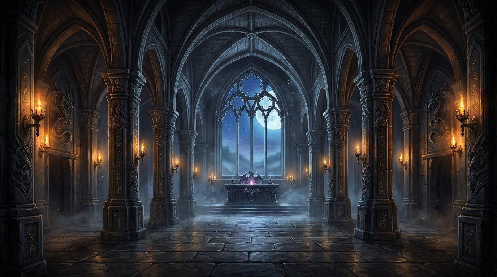
  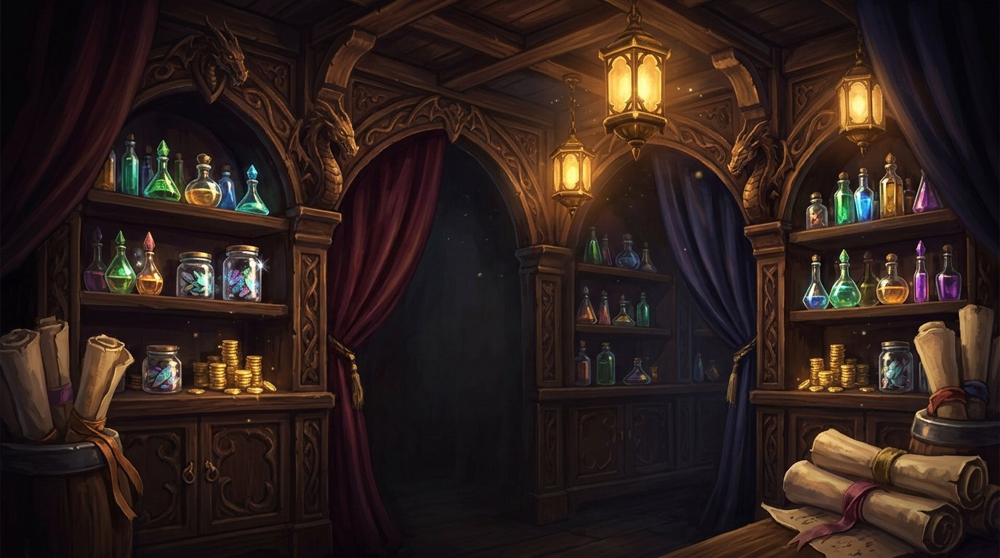
</p>

---

## 🐉 Custom GLSL Shaders & Hybrid 3D Animation

- **Custom PBR/GLSL Shaders (`onBeforeCompile`):** Symmetric 5-stop wing gradients, animated Fresnel rim lighting, *Liquid Mirror* metallic finishes (`metalness: 1.0`, `clearcoat: 1.0`, procedural bioluminescence maps), and *Matte Scales PBR* with normal/roughness maps.
- **Hybrid Skeletal + Procedural Animation:** Combines authored `.glb` clips with additive quaternion wingbeats, bone-hierarchy attachment fixes, and fully articulated procedural creatures (such as the *Glacial Amethyst Mermaid* with an 8-segment sinusoidal tail and flowing hair locks).

<p align="center">
  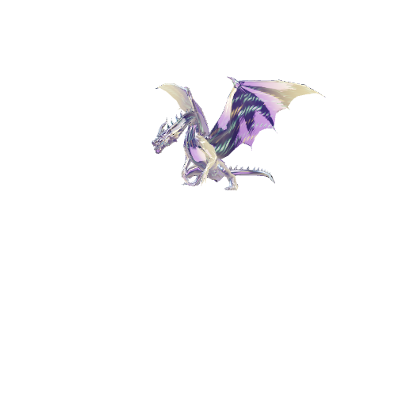
  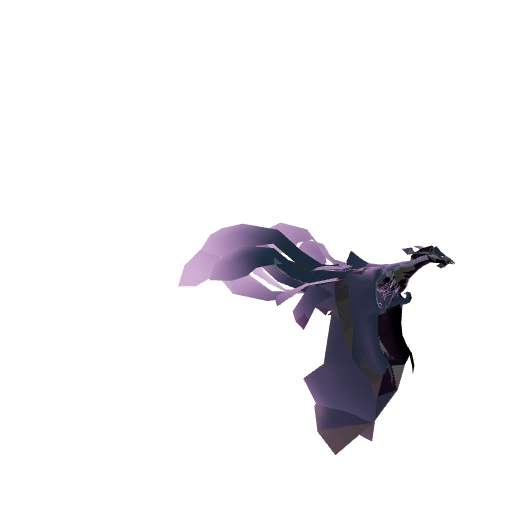
  
  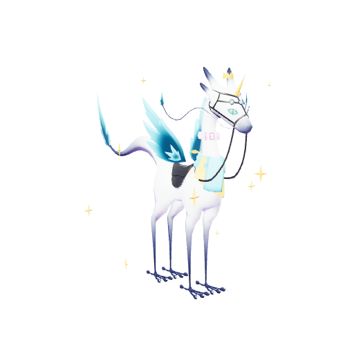
  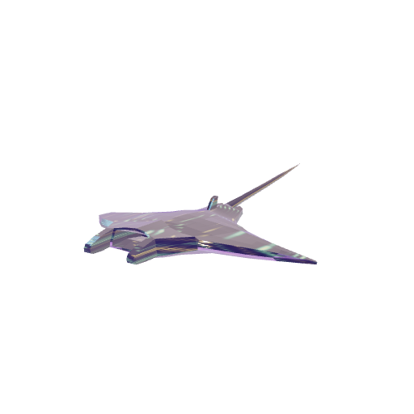
</p>

---

## 🛠️ Tech Stack & Architecture

| Layer | Technologies |
|---|---|
| **3D Graphics** | Three.js, WebGL, custom GLSL (`onBeforeCompile`), `GLTFLoader` + `DRACOLoader`, `PMREMGenerator` |
| **Frontend & UI** | Modular Vanilla JavaScript, HTML5, GPU-accelerated CSS3 (Desktop / iPad / iPhone landscape) |
| **Audio** | Web Audio API (procedural combat SFX & boss stomps) + seamless looping `.m4a` soundtrack |
| **Persistence** | Firebase / Firestore cloud sync + local fallback |
| **Hosting & Build** | Zero-bundler modular pipeline (`src/colony/*.js` → `tools/deploy.py` → `deploy/`) on **Cloudflare Workers** with live version update notifications (`version.json`) |

### Project Structure
```text
├── src/colony/
│   ├── 01-buildings-3d.js   # Colony economy, 3D terrain, camera, day/night cycle & buildings
│   ├── 02-dragons-arena.js  # 31 species, breeding, GLB/procedural 3D builders, PBR shaders & 3D Book
│   └── 03-war-ui.js         # Tactical 3D Arena, combos, cinematics, Forge, Shop, Sanctuary & HUD
├── deploy/                  # Production static build deployed to Cloudflare Workers
├── docs/screenshots/        # Live gameplay screenshots (Universe, Colony, Street, Battle)
├── tools/deploy.py          # Syncs modules, stamps build version, and deploys to Cloudflare Workers
├── firestore.rules          # Firestore security rules
├── wrangler.jsonc           # Cloudflare Workers configuration
├── CREDITS.md               # Open-source libraries & CC0/CC-BY asset attributions
└── LICENSE                  # MIT License
```

---

## 🚀 Running Locally

No bundler or build step required — simply serve the `deploy/` directory with any static HTTP server:

```bash
cd deploy
python3 -m http.server 8080
```

Then open `http://localhost:8080` in your browser.

---

## 👤 Author

Designed and developed by **Gabriel Cestille** — game design, 3D web engineering, shader art direction, and systems architecture.

See [CREDITS.md](CREDITS.md) for third-party libraries and open-licensed 3D/particle assets.
